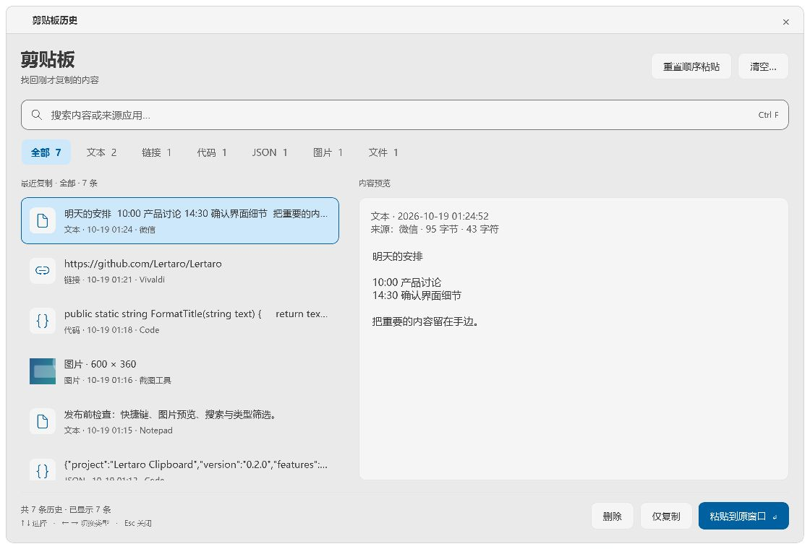
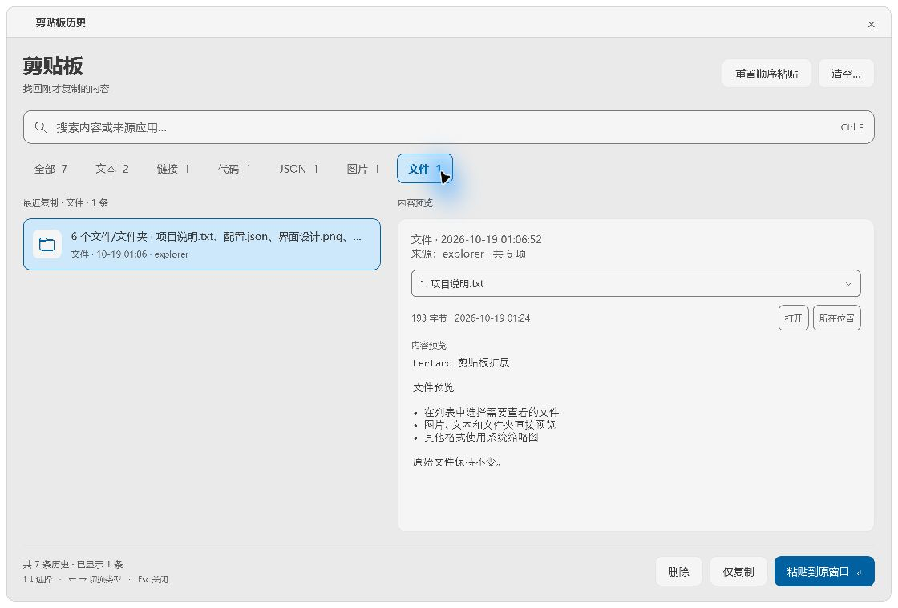

# Lertaro 剪贴板历史

[](https://github.com/jasonchio-cn/Lertaro.Clipboard/actions/workflows/build.yml)

记录文本、图片和文件，按类型查找、预览并粘贴；也支持按复制顺序连续粘贴。使用 Lertaro 原生 Plugin SDK 与 WPF，不需要额外的数据库或界面运行时。

当前版本 0.4.0 适配 **Windows、Lertaro 5.10.0、Plugin SDK 2.3.0**，插件不能独立运行。其他宿主版本尚未验证；构建和安装脚本会检查 SDK 版本。仍使用 Lertaro 5.9.6 / SDK 2.1.3 时，请使用旧版插件 0.3.1。

## 界面

以下截图来自实际运行的示例窗口，使用独立示例数据，不包含个人剪贴板历史。





## 安装

### 手动复制 DLL（推荐）

1. 从 [发行页面](https://github.com/jasonchio-cn/Lertaro.Clipboard/releases) 下载 `Lertaro-Clipboard-版本号.zip`，解压到一个文件夹。GitHub 自动生成的 Source code 压缩包是源码，不含编译好的插件。
2. 完全退出 Lertaro，打开包含 `Lertaro.App.exe` 的安装目录，在其中新建 `Plugins\Lertaro.Plugins.Clipboard` 文件夹（已存在则直接使用）。
3. 将解压得到的 `Lertaro.Plugins.Clipboard.dll` 复制到该文件夹。
4. 重新启动 Lertaro，在插件设置中检查“剪贴板历史”。

安装后的目录结构：

```text
Lertaro/
├── Lertaro.App.exe
└── Plugins/
    └── Lertaro.Plugins.Clipboard/
        └── Lertaro.Plugins.Clipboard.dll
```

可使用发行包中的 `SHA256.txt` 校验 DLL；发行页面还附有整个 ZIP 的 `.sha256` 校验文件。手动复制不会检查宿主 SDK 版本，请先确认使用上文列出的已适配版本。

### 安装脚本（可选）

也可以让脚本完成复制，并自动校验插件 SHA-256 和宿主 SDK 版本。完全退出 Lertaro 后，在解压目录打开 PowerShell，执行下列命令，将示例路径替换为自己的 Lertaro 安装目录，然后重新启动 Lertaro：

```powershell
powershell -NoProfile -ExecutionPolicy Bypass -File .\Install.ps1 -LertaroDir 'C:\Applications\Lertaro'
```

脚本将 DLL 安装到上述插件目录，升级时保留旧 DLL 备份。只有安装目录需要管理员权限时才需要提权；日常运行用普通权限即可。

## 使用

| 操作 | 默认快捷键或入口 |
| --- | --- |
| 打开剪贴板历史 | `Ctrl+Shift+D` |
| 顺序粘贴下一条 | `Ctrl+Shift+V` |
| 粘贴所选记录 | 回车、双击或“粘贴”按钮 |
| 复制所选记录到剪贴板 | `Ctrl+C` 或“复制”按钮；预览中有选中文字时优先复制选中文字 |
| 删除所选记录 | `Ctrl+D` 或“删除”按钮 |
| 搜索 | `Ctrl+F` |
| 操作菜单 | 右键或 `Ctrl+O` |
| 隐藏面板 | `Esc` |

在“设置 → 插件 → 剪贴板历史”修改快捷键、入口词和保留规则。快捷键留空可取消注册；与其他程序冲突时需更换。已有用户设置优先，升级不会覆盖快捷键。

关闭“剪贴板历史”的即时结果组件时，会停止记录并释放监听器、窗口钩子和全局快捷键；重新启用后恢复，不补录关闭期间的内容。已有历史和当前顺序队列保留。整插件开关按宿主要求重启后生效。

面板提供“全部、文本、链接、代码、JSON、图片、文件”标签和数量，左侧选择历史，右侧预览内容。焦点不在文本框时，左右键可切换类型。

也可在 Lertaro 输入 `clip`，使用宿主搜索结果和 QuickLook。支持 `clip /text`、`/url`、`/code`、`/json`、`/image`、`/files`，后面可接搜索词。JSON 格式化只影响预览，实际粘贴保留原文。

## 连续按复制顺序粘贴

1. 在搜索结果或插件设置中执行“重置顺序粘贴”，开始新一批。
2. 按需要的顺序复制内容，例如 A、B、A。
3. 回到目标应用，每按一次 `Ctrl+Shift+V`，依次粘贴 A、B、A。

历史列表去重，顺序队列保留每次复制事件。第一次顺序粘贴会固定当前批次，之后的新复制不会插入本轮；到末尾停止，不循环。开始下一批前再次重置。

队列不跨重启保留。插件检测到粘贴发送失败时不会推进队列；发送成功并不保证目标应用已接受内容。图片和文件也可参与，目标应用需要支持对应格式；在资源管理器中粘贴文件时，应让文件列表获得焦点。

## 文件预览

一条记录包含多个文件时，右侧选择要预览的文件：

- **图片**：显示图片，预览最长边限制为 1600 像素，保留原始尺寸信息。
- **文本、代码、JSON**：只读预览，支持 UTF-8 和带 BOM 的 Unicode 文本；最多读取前 100,000 个字符。
- **文件夹**：列出前 200 个直接子项，不递归扫描。
- **其他格式**：使用 Lertaro 的系统缩略图服务，效果取决于 Windows 的缩略图处理器；不提供完整的 PDF 或 Office 阅读器。

切换预览不会执行文件；只有主动选择“打开”或“所在位置”才调用外部应用。历史只保存文件路径，文件移动、删除或无权访问时会显示对应状态，不会恢复原文件。

## 存储与隐私

文本和图片保存在 Lertaro 为本插件提供的用户数据目录下的 `ClipboardHistory` 中，包括 `history.json` 和图片目录。文件记录保存原始路径，不保存文件副本。

**历史是未加密的本地数据**。本版本不提供敏感内容遮罩、排除特定应用或遵循“禁止记录”标记的功能；复制的密码等内容也可能被记录。不要把插件用户数据目录上传到仓库或分享给别人。

默认限制为 1,000 条、90 天、总容量 256 MB；单张图片最大 128 MB，单条文本最大 10 MB。可在插件设置中调整。置顶收藏、颜色识别和颜色分类不在本版本范围内。

## 升级与停用

完全退出 Lertaro 后，用新版发行包中的 DLL 替换上述插件目录内的同名文件，再启动宿主；建议替换前将旧 DLL 备份到插件目录之外。也可使用新版发行包的安装脚本升级，脚本会保留旧 DLL 备份。两种方式均不会清空个人历史。

临时停用可在宿主插件设置中关闭插件，或退出宿主后执行：

```powershell
powershell -NoProfile -ExecutionPolicy Bypass -File .\Install.ps1 -LertaroDir 'C:\Applications\Lertaro' -Uninstall
```

## 从源码构建

需要 Windows 和 .NET 10 SDK。仓库不包含宿主或 SDK DLL；`Prepare-Sdk.ps1` 从官方固定版本发行包提取 SDK，验证发行包 SHA-256，不安装或执行宿主。

```powershell
git clone https://github.com/jasonchio-cn/Lertaro.Clipboard.git
cd Lertaro.Clipboard
.\Prepare-Sdk.ps1
.\Build.ps1
.\Package.ps1
```

`Package.ps1` 会构建、运行单元测试，并生成 `artifacts\Lertaro-Clipboard-版本号.zip` 和校验文件。GitHub Actions 也执行相同流程，但不会自动发布 Release。

若使用本机已安装的 SDK，可设置 `LERTARO_DIR` 环境变量，或在忽略的 `Local.props` 中配置：

```xml
<Project>
  <PropertyGroup>
    <LertaroDir>C:\Applications\Lertaro</LertaroDir>
  </PropertyGroup>
</Project>
```

也可向构建或打包脚本传入 `-LertaroDir`。本机工具、测试数据与输出放在忽略的 `.local/`、`artifacts/` 中。

构建只接受 SDK 2.3.0，并核对最终解析的 SDK 路径；Tests/Harness 的构建产物不会参与 SDK 引用解析。单元测试还会核对编译后 DLL 的 SDK 引用版本。

界面检查与示例窗口需要完整宿主的主题资源；以下命令只使用独立示例数据，示例窗口中的复制、粘贴按钮不操作系统剪贴板：

```powershell
dotnet run --project .\Harness\Clipboard.Harness.csproj -c Release -- --demo --host 'C:\Applications\Lertaro' '.local\demo'
dotnet run --project .\Harness\Clipboard.Harness.csproj -c Release -- --render --host 'C:\Applications\Lertaro' '.local\ui-checks'
```

Harness 中其他集成测试及 `--live-probe` 会操作真实剪贴板，仅用于显式启动的本机验证。

## 分享给其他人

直接分享 [Release 下载页](https://github.com/jasonchio-cn/Lertaro.Clipboard/releases/latest)，或者发送其中的安装 ZIP 与 `.sha256` 文件。对方需要先安装兼容版本的 Lertaro，再按本文安装步骤导入插件。

不要分发个人历史、本机配置、测试日志或整个 Lertaro 安装目录。源码协作使用本仓库；可安装文件使用 Release。

## 已知限制

普通权限的宿主可能无法向管理员权限窗口发送粘贴。目标窗口关闭、焦点变化或应用不支持某种剪贴板格式时也可能失败。极短时间内被其他程序覆盖的剪贴板变化不保证全部捕获。

当前适配 SDK 2.3.0；其他版本需要重新验证。文件缩略图依赖 Windows 环境。

## 许可证与参考

源码采用 [MIT 许可证](LICENSE)，Copyright © 2026 jasonchio-cn。

依赖 [Lertaro](https://github.com/Lertaro/Lertaro) 的 Plugin SDK。功能设计参考了 [ZTools](https://github.com/codingmuse/ZTools) 及其[扩展项目](https://github.com/codingmuse/ZTools-extensions)；本仓库使用 C# / WPF 独立实现，不包含 ZTools 源码。宿主及第三方软件的许可证分别适用。
